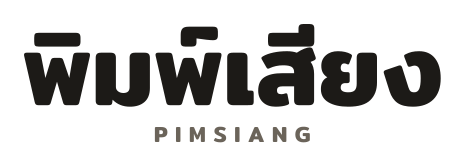
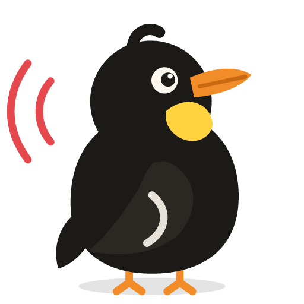

<p align="center">
  
</p>

<p align="center">
  <picture>
    <source media="(prefers-color-scheme: dark)" srcset="docs/brand/pimsiang-wordmark-dark.svg">
    
  </picture>
</p>

<p align="center"><b>Thai dictation for macOS. Hold a key, speak Thai, release.</b><br>Speech recognition runs on your Mac.</p>

<p align="center">
  <a href="https://github.com/PingSunn/pimsiang/releases/latest"></a>
  
  <a href="#install"></a>
  <a href="LICENSE"></a>
</p>

<p align="center">
  <a href="https://openthai.ai/openthai2p0-asr-streaming?ref=powered-by" target="_blank" rel="noopener"></a>
</p>

<p align="center">
  <a href="#install">Install</a> · <a href="#usage">Usage</a> · <a href="#privacy">Privacy</a> · <a href="README.th.md">ภาษาไทย</a>
</p>

<!--
Screenshots: add the files below, then remove this comment.

<p align="center">
  
</p>
<p align="center">
  
  
</p>
-->

Hold a key, speak Thai, release, and the text is typed into the app you are working in. While you speak, a small Pill at the top of the screen shows the words as they are recognised. Apple Silicon, macOS 14 (Sonoma) or newer.

## Install

```sh
brew install --cask PingSunn/tap/pimsiang
```

Upgrade later with `brew upgrade --cask PingSunn/tap/pimsiang`. The app tells you in its menu bar when a new version exists; it never updates itself.

### Open Anyway (once)

PimSiang is signed with a self-signed certificate, not notarized by Apple, so macOS blocks the first launch.

1. Open PimSiang from Applications. macOS says it cannot verify the app; click Done.
2. Open System Settings, then Privacy & Security, scroll to Security and click **Open Anyway** next to PimSiang.
3. Confirm with your password or Touch ID and open the app.

You only do this once. Updates keep working with the permissions you granted.

## Permissions

PimSiang asks for three permissions and shows where to grant each on first launch.

- **Microphone**: to hear you while the Trigger key is held.
- **Accessibility**: to find the focused text field and paste the text.
- **Input Monitoring**: to see the Trigger key (listen only; PimSiang does not record other keys).

## First launch: Model download

<picture>
  <source media="(prefers-color-scheme: dark)" srcset="docs/brand/exports/pimsiang-myna-searching-dark-512.png">
  
</picture>

The speech Model is about 1 GB and is downloaded on first launch from Hugging Face (the Silero voice-activity file from GitHub), verified by checksum and stored in `~/Library/Application Support/PimSiang`. Dictation is available once the download finishes. Choosing Accurate under Settings, General, downloads the full-size Model (about 2.6 GB, more memory) in the background and switches to it when it is ready.

## Usage

<picture>
  <source media="(prefers-color-scheme: dark)" srcset="docs/brand/exports/pimsiang-myna-listening-dark-512.png">
  
</picture>

- **Hold Right Option**, speak, release: the text is typed where the cursor is.
- **Double-tap Right Option** to start Hands-free; tap once to finish.
- **Hold Shift with Right Option** for a Quick note: the text is kept in History instead of being typed.
- **Esc** cancels the current Utterance.

If no text field is focused, the text is kept as a Note in History. The Trigger key can be changed in settings.

## Privacy

<picture>
  <source media="(prefers-color-scheme: dark)" srcset="docs/brand/exports/pimsiang-myna-sleeping-dark-512.png">
  
</picture>

- Audio is never stored and never leaves your Mac.
- History keeps text only, on your Mac.
- No telemetry and no crash reporting.
- The only network calls are the Model download (Hugging Face and GitHub) and a once-a-day check of GitHub Releases for a newer version.

## Uninstall

<picture>
  <source media="(prefers-color-scheme: dark)" srcset="docs/brand/exports/pimsiang-myna-waving-dark-512.png">
  
</picture>

```sh
brew uninstall --cask PingSunn/tap/pimsiang
```

To also delete the Model, History, settings and logs:

```sh
brew uninstall --cask --zap PingSunn/tap/pimsiang
```

## Licences

PimSiang is MIT licensed (see `LICENSE`). Bundled and downloaded components keep their own licences: the OpenThai 2.0 ASR Model (iApp) under OpenMDW-1.1, Silero VAD under MIT, and the Anuphan font under the SIL Open Font License 1.1.

## Development

`scripts/check.sh` runs format, build, clippy and tests. `scripts/make-signing-cert.sh` creates the local signing certificate once. `scripts/release.sh X.Y.Z --dry-run` builds, signs and zips a release into `target/release-dist/` without publishing.

`scripts/e2e/run.sh --yes` drives the running app with synthetic keys and Thai text-to-speech to check the whole flow; it takes over the keyboard and speakers (see `docs/adr/0042-e2e-harness-synthetic-events-and-tts.md`).
